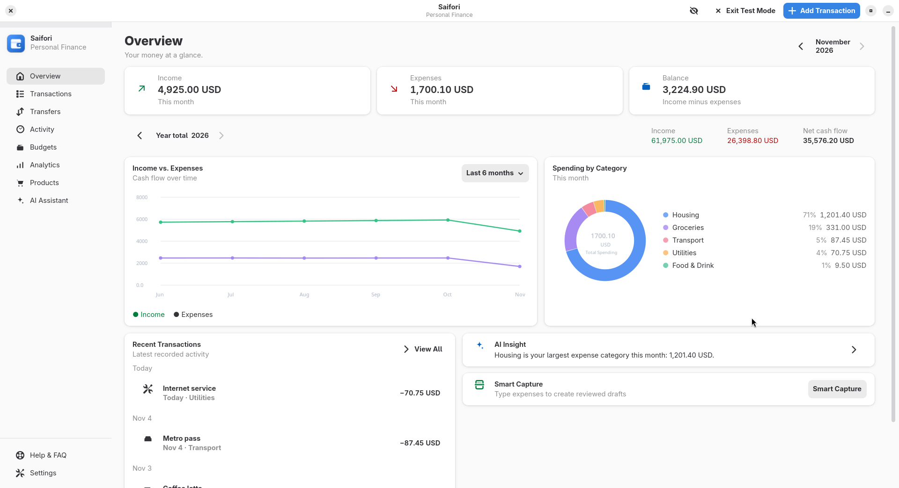

# Saifori

A personal finance application for Linux, built with Rust, GTK4, Libadwaita and
SQLite. Track your money locally, with core features that work offline without
an account.



## Features

- Record income and expenses, manage categories and plan budgets.
- Review spending trends, monthly reports and product summaries.
- Track account transfers separately from income and spending.
- Export transactions and backups as CSV or JSON.
- Optionally use Smart Capture and chat with your own DeepSeek, Claude or OpenAI key.
- Explore synthetic USD records in Test Mode without changing your personal ledger.

The interface supports English and Spanish.

## Install

Development Flatpak bundles are built through GitHub Actions. Open
[Actions → Flatpak](https://github.com/oeiv/saifori/actions/workflows/flatpak.yml),
select a successful run, and download **Saifori-flatpak-x86_64** from its artifacts.
Extract the archive, then install and launch on a Flatpak-enabled Linux system:

```bash
flatpak install --user ./Saifori.flatpak
flatpak run io.github.oeiv.Saifori
```

These are development builds; the application is not published on Flathub.

## Build from source

Requirements: Rust 1.92+, GTK 4.12+, Libadwaita 1.4+, libsecret, `pkg-config` and a
C compiler. On Fedora:

```bash
sudo dnf install rust cargo gtk4-devel libadwaita-devel libsecret-devel pkgconf-pkg-config gcc
cargo build --release --locked
./target/release/saifori
```

## Privacy

The ledger, conversations and exported files are **not encrypted**. Privacy Mode
only hides information on screen. Provider keys are stored in GNOME Keyring /
Secret Service. Optional AI requests send submitted text, recent chat context
and financial aggregates to the selected provider and may incur usage charges.

See [PRIVACY.md](PRIVACY.md) for data handling and [SECURITY.md](SECURITY.md) for
reporting vulnerabilities.

## Contributing

See [CONTRIBUTING.md](CONTRIBUTING.md) for tests, Flatpak packaging and data
migration. AI assistance contributed to implementation, refactoring, tests,
build tooling, metadata and documentation; the development manifest is also
AI-assisted. See the [distribution guidance](CONTRIBUTING.md#distribution) before
preparing a Flathub submission.

## License

[MIT](LICENSE).
